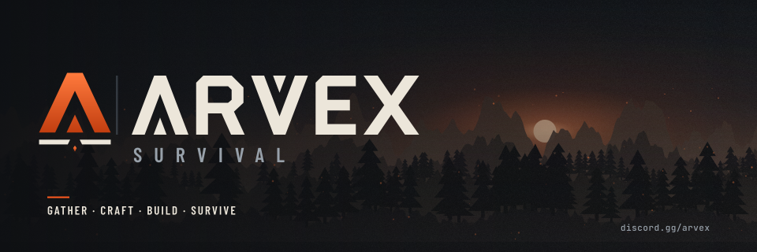

# ARVEX SURVIVAL



**ARVEX SURVIVAL** منظومة كاملة: لعبة بقاء عالم مفتوح، لانشر رسمي، سيرفرات أونلاين، وهوية بصرية.

- **Owner / Dev:** Mohsen
- **Co Owner:** Danial
- **Staff / Community:** [discord.gg/arvex](https://discord.gg/arvex)

## وش فيها

- **جزيرة عالم مفتوح:** طولها 1.5 كم، فيها غابات وجبال ونهرين وبحيرات وشواطئ وأنقاض ومواقع مهجورة ومخيمات وأبراج.
- **حركة FPS:** WASD صحيحة ومرتبطة بالكاميرا (W للأمام، S للخلف، A يسار، D يمين). فيها مشي وجري وركض سريع وقفز وانحناء وسباحة، مع تسارع وتباطؤ ناعم وتصادم.
- **البقاء:** صحة، جوع، عطش، طاقة، حرارة جسم. ومعها حالات: نزيف، تسمم، بلل، برد، دفء، شبع.
- **الجمع:** تقطع أشجار تطيح فعلياً، وتكسر صخور وخام حديد، وتجمع قنب وتوت وحطب وحجارة. كل ضربة لها صوت ومؤثرات.
- **الصناعة:** 35 وصفة، طابور صناعة، وطاولتين عمل تفتح لك المستويات.
- **البناء:** أساس، أرضية، جدار، باب، شباك، سقف، درج، عمود. القطع تلتصق ببعض وتدورها، ويتحقق من التصادم والدعم والموارد. تقدر تطوّرها (قش ← خشب ← حجر ← حديد) وتصلحها وتهدمها، وتركّب أبواب وصناديق ونار وفرن وكيس نوم.
- **القتال:** أسلحة يدوية، قوس بسحب، ونشاب بتلقيم. فيها ارتداد وانتشار للتصويب، وعلامة إصابة، واهتزاز كاميرا.
- **الحيوانات:** غزال، خنزير بري، ذيب، دب. كل واحد له ذكاء اصطناعي: يتجول، يهرب، يطارد، يهاجم. وتقدر تسلخها بعد ما تموت.
- **العالم الحي:** ليل ونهار مع شمس وقمر ونجوم. طقس متغير (صحو، غائم، مطر، عاصفة مع برق ورعد، ضباب)، موية فيها موج ورغوة شاطئ، وإضاءة نار وشعلة.
- **الصوت:** كله يتولّد داخل اللعبة. خطوات حسب الأرض، طيور بالنهار، صراصير بالليل، موج، مطر، ريح، نار، أصوات حيوانات، وموسيقى تتغير مع الخطر.
- **الواجهة:** HUD كامل، حقيبة بالسحب والإفلات والتقسيم واللبس، شاشة صناعة، قوائم دائرية، خريطة، قائمة رئيسية فيها مشهد ثلاثي الأبعاد حي، إعدادات كاملة (رسوم وصوت وتحكم بتعديل الأزرار وسهولة وصول)، وتدعم العربي والإنجليزي.
- **المنصات:** كمبيوتر (لانشر ويندوز)، أندرويد وآيفون وآيباد (تطبيق ويب PWA بتحكم لمس)، ويد إكس بوكس وبلايستيشن.

## الروابط
- اللعبة والسيرفر: **https://emberwing.onrender.com**
- اللانشر: `https://emberwing.onrender.com/download/ARVEX-Launcher.exe`
- نسخة احتياطية: https://gotohel12.github.io/emberwing/

> رابط Render لسا باسم `emberwing` لأن اسم الخدمة ما يتغير من الكود. تقدر تغيّره من لوحة Render.

## التشغيل
| المنصة | الطريقة |
|---|---|
| ويندوز | شغّل `ARVEX-Launcher.exe` واضغط **تثبيت** ثم **العب** |
| آيفون / آيباد | افتح الرابط في **Safari** ← مشاركة ← **إضافة إلى الشاشة الرئيسية** |
| أندرويد | افتح الرابط في **Chrome** ← ⋮ ← **تثبيت التطبيق** |

## التحكم
| | كيبورد + ماوس | يد تحكم |
|---|---|---|
| حركة | WASD | العصا اليسرى |
| كاميرا | الماوس | العصا اليمنى |
| قفز / انحناء / ركض سريع | Space / Ctrl أو C / Shift | A / B / ضغطة العصا اليسرى |
| ضرب واستخدام / تصويب أو قائمة | كليك يسار / كليك يمين | RT / LT |
| تفاعل / تلقيم أو تدوير | E / R | X / ضغطة العصا اليمنى |
| الحقيبة / الصناعة / الخريطة | Tab / Q / M | Y / — / Back |
| الحزام | 1–6 أو عجلة الماوس | LB / RB |

---

## Technical overview (English)

```
brand/        identity source: logo, LINE, banners, PFP, icons (SVG + PNG). Generated by tools/brand.py
public/       the game client (served by Render, GitHub Pages and the launcher)
  arvex.css   the ARVEX design system: tokens + components, shared with the launcher
src/          game source (bundled to public/game.js by esbuild)
  core/       math
  gfx/        WebGL renderer (24-bit depth, sky, water, rain, point lights, bloom), mesh builder, procedural models, particles
  world/      terrain generator (shared with the server), chunked world, collision, raycasting
  game/       session, player, inventory, items, building, animals, env (day/night + weather)
  ui/         screens, HUD, inventory/crafting, radial menus, map, touch, icons
  audio/      procedural score, ambience and positional SFX
  input/      keyboard/mouse, gamepads, touch
  net/        server browser + WebSocket sync
server/       Node backend: shards, world simulation, playtime, restarts, REST API
  lib/        auth, RBAC, audit log, release registry + signed manifests, admin API, remote config
  admin-ui/   staff admin panel served at /admin
launcher/     Go launcher (Windows): signed manifests, compressed parallel downloads, resume, delta updates, verify/repair, rollback, self-update
tests/        admin/backend, server protocol, restart/queue, launcher + update engine (173 checks)
design/       DESIGN_SYSTEM.md, OPERATIONS.md, TEST_REPORT.md
tools/        build.mjs (version + build id), release.sh, keygen.mjs, brand.py, blender/
```

### Version
**v10.0** (`10.0.0`). `package.json` is the only place the version is written; `tools/build.mjs` derives a reproducible build id (`10.0.0-<content hash>`) and writes `public/build.json`. The game, the backend, the manifest and the launcher all read from there. Full details, including how to publish, roll back and sign releases: [`design/OPERATIONS.md`](design/OPERATIONS.md).

### Server
- `npm start` runs `server/server.mjs`. It serves the game, the public API, the admin API, the admin panel and the launcher files on `PORT`.
- **Shards:** 4 game servers in one process by default (`eu-1` MAIN PvE, `eu-2` PvP, `eu-3` Build, `eu-4` Hardcore). Each one has its own world, seed, save and restart schedule. To override, set `SERVERS_JSON`.
- **Authoritative state on the server:** world (nodes, structures, deployables, drops), animals, fires and furnaces, time and weather, ownership checks, player counts, playtime, bans/mutes, hit rate/range/damage limits per weapon.
- **Restarts:** every 5 days per shard, staggered, with warnings at 60/30/15/10/5/1 min, 30 s and 10 s. The schedule survives deploys (`schedule.json`).
- **Persistence:** JSON files in `DATA_DIR` (default `./data`). **On Render's free plan the disk is wiped on every deploy and restart.** To keep worlds, playtime, staff accounts, bans, tickets, uploaded releases and the audit log, attach a Render Disk and set `DATA_DIR` to its mount path.
- **Admin panel:** `/admin`. First run asks once for the owner key (`ADMIN_KEY`) and creates the OWNER account; after that staff sign in with username + password (scrypt), optional 2FA. Roles: Owner, Admin, Developer, Moderator, Support, enforced on the server. Every action is written to a hash-chained audit log.
- **Environment:** `ADMIN_KEY`, `ARVEX_SIGN_KEY` (Ed25519 private key for signing manifests; never commit it), `DATA_DIR`, `AUTO_PUBLISH_BUNDLED`, `TRUST_PROXY`, `LOG_LEVEL`, `SERVERS_JSON`, `RESTART_MS`.

### Launcher
- Reads `/launcher/manifest.json?channel=…`: every file with size, SHA-256 and compressed size, plus version, build id, release date, minimum version and an Ed25519 signature.
- Downloads only changed files, gzip-compressed (code and models shrink about 4x; the JPG textures are already compressed, so a full install is 49 MB of download for 70 MB on disk), 1–6 in parallel, with HTTP Range resume, retry with backoff and a shared speed limit. Each file is hashed before staging and again after install.
- Installs through a journal and a backup: a failure or crash during install is rolled back on the same run or the next start. Verify and repair re-hash the install and fetch only bad files.
- Refuses unsigned, tampered or replayed manifests once it has seen a signed one from its server. Self-update must match a published SHA-256.
- Shows installed/latest version and build, update size, free disk space, server status, maintenance and mandatory-update banners, news, patch notes, support tickets, and error codes (`ARVEX-L/N/U/F/A/S…`) with a log file.
- **Settings:** install and download location, speed limit, parallel downloads, auto update, auto repair, start with Windows, language, update server, channel, close on play, notifications, error reports.

### Release
1. Bump `version` in `package.json`, add the entry to `server/versions.json` (and news to `server/news.json`).
2. `./tools/release.sh` builds `public/game.js`, `public/build.json`, `public/download/ARVEX-Launcher.exe` and `docs/`.
3. `node tests/run-all.mjs --launcher`
4. Push, then on Render: **Manual Deploy → Deploy latest commit**. The deployed build becomes the live stable release; or upload and promote a release by hand in **Admin → Releases**.

### Graphics
Surfaces use photographed PBR textures (CC0, Poly Haven; list in `public/textures/LICENSE.txt`): albedo + normal + roughness, projected triplanar because the meshes have no UVs, lit with a GGX specular model. Terrain blends grass, dirt, sand and rock by height, slope and noise. Materials are tagged on the palette (`MAT` in `src/gfx/models.js`) and on Blender slots (`src/gfx/blender.js`); texture sets and scales are in `src/gfx/textures.js`. Texture sizes: 1K, 2K, or 4K for the large surfaces (about 1.1 GB of video memory; the MAX preset). "Surface textures: Off" (the LOW preset) uses the original flat-colour shader. The first-person arm is an anatomical model built with MPFB in Blender (`tools/blender/`). Trees and grass are alpha-cut cards from a foliage atlas (`tools/foliage_atlas.py`): a card vertex stores its UV in the normal slot and the shader rebuilds a rounded canopy normal, so the mesh format did not change.

### Size
The game is **220 MB** installed plus an 8.2 MB launcher: 146 MB of 4K textures, 33 MB of 2K, 8 MB of 1K and 27 MB of Blender models. The launcher installs everything; the web and mobile version download only the texture size selected in the settings (phones default to 1K or off) and the GitHub Pages mirror carries 1K only. The size is what the real content weighs: nothing is padded to reach a number.

© 2026 ARVEX — Mohsen ~ Danial. Typefaces: Barlow Condensed, IBM Plex Sans Arabic, Noto Kufi Arabic, JetBrains Mono (SIL OFL 1.1, licences in `public/fonts/`).
